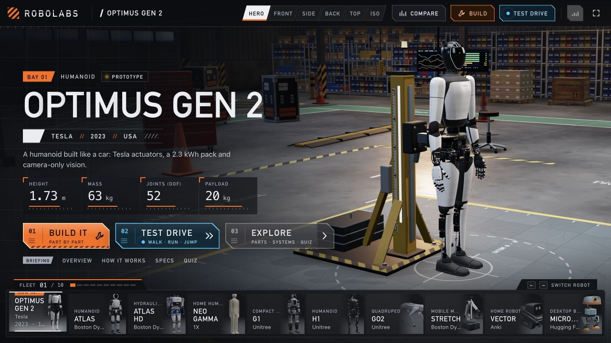
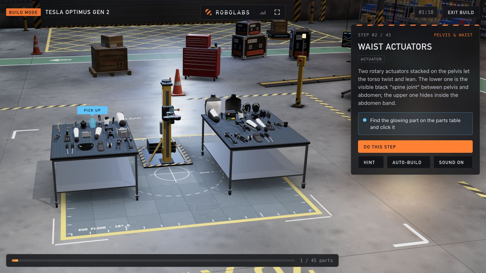

# RobotForge workspace direction — RoboLabs reference

Status: reference study and proposed design. No application redesign is implemented by this document.

## Sources and capture context

Primary reference: [RoboLabs](https://robolabs-app.vercel.app/), supplied by the owner. Inspected its Optimus overview and guided Build mode on 2026-11-11 (owner's local date), in a 1280 × 720 desktop browser. Firecrawl supplied live page text/branding; browser screenshots and DOM-backed computed styles supplied visual evidence. The page resolved to `/?robot=optimus`; Build mode used `/?robot=optimus&build=1`.

Observed a build interaction advance from step 1 to step 2 and progress from 0/45 to 1/45. This establishes the visible guided interaction, not physical assembly accuracy, test-drive physics or fidelity of the model. Mobile behavior and other robot models were not evaluated.

## What to bring into RobotForge

| Observed reference pattern | RobotForge adaptation | Improvement to target |
| --- | --- | --- |
| Robot shown inside a full-window workshop with floor markings, racks, benches and a fixture | Make the existing Workshop a scene with small, anchored controls | Open on the robot, without scrolling past banners or explanation cards |
| Thin top toolbar with camera presets and Build/Test drive actions | Compact navigation/header plus Build, Wire, Test workspace modes | One mode row, fewer camera buttons, no second tab row |
| Thumbnail fleet dock with active-robot emphasis | Visual shelf for your saved robots and separately labeled reference models | Search/filter larger collections; preserve selection/drafts when switching |
| Guided Build replaces the overview with a parts-table scene and one right-hand step panel | Start assembly practice from Build and show the current part, one instruction and Next/Hint | Resume progress, keyboard/touch equivalents and clearer completion feedback |
| Glowing target part and progress strip | Highlight the target or selected part and show compact progress | Do not depend on glow alone; include a named, focusable part entry |
| Direct camera presets, exploded inspection and layers | Fit/Front/Side presets and visible Separate parts/visibility controls | No nested view/layer menus; selecting a part opens its properties |
| Overview and build have distinct, focused compositions | Keep one stable workspace and swap its contextual panel | Wrench, properties and build help share one panel area instead of piling up |

## What to simplify further

The reference overview still has a large title, repeated Build/Test entry points, briefing links, six camera presets and substantial text. Do not reproduce that density. Its guided Build panel also contains a paragraph; use one actionable sentence by default, with an optional explanation.

Do not add music controls, quizzes, animated telemetry, decorative technical readouts or a permanent Compare destination during this cleanup. Retain comparison where it helps a version/part decision. Cinematic camera moves must be optional and respect reduced motion.

## Proposed desktop composition

- **Top:** RobotForge identity, compact Workshop/Library/Robots navigation, robot name/status and Save/Versions. No large introduction heading inside the working scene.
- **Main:** The robot and workshop fill the available area. Aim for roughly 70% of desktop workspace width for the scene while the tool panel is open; expand when it closes.
- **Mode controls:** Build, Wire, Test, in one small row. Design and assembly belong under Build.
- **Right:** One 320–360 px contextual panel as a starting design target. It shows selected-part properties, design/assembly steps, test results or Wrench conversation, never several stacked panels.
- **Robot shelf:** Thumbnail strip along the lower scene edge, outside the right panel. It must not overlap scene controls. For large collections, a searchable visual chooser replaces an endlessly growing strip.
- **Wrench:** A compact composer anchored within the right panel area. Replies use that same area. Remove the current long floating bar that covers the scene's lower controls.

Panel width, spacing and the scene ratio are proposed layout values, not extracted reference CSS. On phones, use the canvas plus one bottom sheet at a time; robot switching is a horizontal visual chooser, and Wrench replaces that sheet when opened.

## Styling evidence and proposed tokens

| Role | Observed RoboLabs evidence | RobotForge proposal |
| --- | --- | --- |
| Base background | `#0B0D10`, computed body style | Charcoal `#0B0D10` |
| Main text | `#ECEFF3`, computed body/heading style | `#ECEFF3`; strong contrast in controls |
| Action/selection accents | Firecrawl reports orange `#FF6A00` and cyan `#28C8FF`; screenshots show orange Build, cyan interaction highlights | Keep RobotForge teal as the main action/selection accent; amber reserved for warnings/current step |
| Body typography | Computed body stack: Inter, Segoe UI, system-ui, sans-serif; default 14 px | Existing bundled/system fonts; 14–16 px body, at least 16 px on mobile form inputs |
| Display typography | Computed heading/button stack: Bahnschrift, DIN Alternate, Oswald, Arial Narrow, sans-serif | A compact semibold heading using available fonts; no oversized hero title within the workspace |
| Display sizing | Browser heading was 75.52 px at 1280 px width; scraper reported a different heading size | Responsive compact robot title, approximately 20–28 px; prototype and verify |
| Edges | Sampled body/header/action button radii: 0 px; screenshot shows angular outlined buttons | Mostly flat surfaces, restrained borders and small 4–8 px radii |
| Spacing | Scraper reports a 10 px base unit; not confirmed as a complete CSS scale | Proposed 4/8/12/16/24 spacing scale |

The scraper's brand-name guess was “Optimus Gen 2”; the actual site header says RoboLabs. Its reported component colors/sizes are extraction hints, not a complete authoritative stylesheet. Keep measured samples, visual observations and our design decisions separate.

## RobotForge improvements beyond the reference

1. **Work on your own robot:** saved projects, editable specs, real parts library, imports and reversible versions.
2. **Build and wire together:** part selection, mounting context and connection/power issues share the same project.
3. **Wrench acts in context:** short answers and confirmed visual changes; proposals still require Apply before saved data changes.
4. **Useful tests:** compact results tied to the actual engine and recorded inputs. Keep reference inspection, estimated physics and hardware evidence distinct.
5. **Less reading:** short labels, direct actions and an optional explanation; no repeated disclaimers or technical bridge messages.
6. **Better access:** keyboard selection, named part lists, usable touch controls, reduced motion, basic-view fallback and no mandatory walking/fullscreen.

These are product targets, not claims that all features or engine parity already exist.

## Assets and implementation boundaries

The screenshots above document the reference. Its robot thumbnail URLs follow `/img/robots/*.png` (for example `https://robolabs-app.vercel.app/img/robots/g1.png`); these were observed as UI images, not imported or approved production assets. No scene/model source or asset license was established by this review.

Use RobotForge branding and its existing licensed manufacturer models. Build original workshop furnishings/lighting, with Blender assets where useful, and retain their editable sources and provenance. Do not use scraped artwork, robot models, branding or source code as project assets without an established license. The UI pattern can guide an original implementation.

Keep the existing Unity/basic renderers and saved-data ownership. First prove the redesigned shell and guided interactions; then polish the scene's benches, trays, storage, lighting and test area. A rendered workshop or animated assembly sequence is not verified hardware assembly or a gait controller.

## Prototype gate

Produce a clickable Workshop prototype on a reversible branch with G1 and one saved rover, using real app state. Demonstrate switch robot → select part → edit/inspect → guided step → Wire → Test → ask Wrench → save/version. Compare against these captured screens and the simplification targets in `2026-11-11-simplify-robotforge.md`.

Review desktop and phone previews before implementation rollout. No redesign is published as part of this reference-study task.
